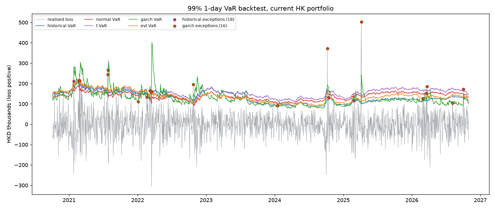

# HK Market-Risk Assistant

[](https://github.com/Trollinglolin/riak-assistant/actions/workflows/ci.yml)

**Live demo:** https://hkrisk.jollymushroom-951ccee3.francecentral.azurecontainerapps.io. It is usually **switched off** to save cloud credit; see [Running it again](#running-it-again). The risk dashboard is public when it's on; the chat needs an access key because it spends LLM quota.

A tested Python VaR / ES / GARCH / EVT engine for a portfolio of Hong Kong equities, with
backtests (Kupiec, Christoffersen, Basel traffic light), risk attribution, stress tests, a
FastAPI service, and an LLM agent that answers risk questions **only through tool calls** to
the engine. The agent does no arithmetic: every number it quotes must appear in a tool result,
and the eval measures that.

```
 yfinance ─► data.py (Parquet cache, frozen snapshot 2007→2026-10-30)
             portfolio.py  holdings → HKD hypothetical P&L
             var_models.py historical / normal / Student-t / GARCH-FHS     pure Python,
             evt.py        GPD peaks-over-threshold                       144 tests
             backtest.py   Kupiec / Christoffersen / traffic light
             attribution.py Euler component VaR / ES, explain-change
             stress.py     2008 / 2020 / 2022 replays, β-proxy, HSI shocks
                  │ service.py (JSON-safe facade)
      ┌───────────┼──────────────────────┐
  FastAPI      agent tools + loop      daily report (Lambda → S3)
  /risk/...    (Gemini/Groq/OpenRouter/Ollama free, or Anthropic)
```

## Running it again

### 1. Locally (free, about 2 minutes)

You need: [uv](https://docs.astral.sh/uv/), Node 22+, and a free Gemini key from
https://aistudio.google.com (only for the chat and eval).

```bash
uv sync                                   # Python 3.12 + dependencies
uv run pytest                             # 144 tests, offline, should all pass
cp .env.example .env                      # first time only, then edit .env:
#   GEMINI_API_KEY=<your key>
#   HKRISK_API_KEY=<32+ random chars>  ->  python -c "import secrets; print(secrets.token_urlsafe(32))"
```

Then open two terminals:

```bash
# terminal 1: the API on http://127.0.0.1:8000
uv run uvicorn hkrisk.api.main:app --reload

# terminal 2: the dashboard on http://localhost:5173
cd dashboard && npm install && npm run dev
```

Open http://localhost:5173. Switch between the `Core 9` and `HSI 95` books at the top right.
The chat works straight away, because the dev server adds your `HKRISK_API_KEY` for you.
Stop both servers with `Ctrl+C`.

Without the dashboard:

```bash
uv run hkrisk var --method garch                    # one VaR number (core book)
uv run hkrisk var --portfolio hsi                   # all 95 Hang Seng Index stocks
uv run hkrisk ask "What's my 99% VaR and what drove it this week?"
uv run python evals/run_eval.py                     # 65-question eval, ~140 Gemini requests
uv run python scripts/run_backtests.py              # backtest tables + charts -> docs/
```

### 2. The hosted site on Azure

Check what state it is in first:

```bash
az login                                  # once per machine / when the token expires
infra/azure/hosting.sh status             # app Running/Stopped, and whether the registry exists
```

**If `registry: ... (exists)`**, start it in about 40 seconds:

```bash
infra/azure/hosting.sh on
```

**If `registry: deleted`** (the cheapest "off" state), rebuild and push the image first
(about 10-15 minutes, mostly the x86 build under emulation on Apple Silicon):

```bash
colima start                                                       # local Docker
docker run --privileged --rm tonistiigi/binfmt:qemu-v9.2.2 --install amd64     # x86 emulation, after each colima start
BUILD=local infra/azure/deploy.sh                                  # recreate registry, build, push, update app
infra/azure/hosting.sh on
colima stop                                                        # optional, frees memory
```

`deploy.sh` reads `GEMINI_API_KEY` and `HKRISK_API_KEY` from `.env` and stores them as Azure
secrets; it never prints them. The hosted chat asks visitors for the access key, which is the
`HKRISK_API_KEY` value. Share it only with people you want using your LLM quota.

**Turning it off again:**

```bash
infra/azure/hosting.sh off                     # stop the app: site offline, no compute cost
infra/azure/hosting.sh off --delete-registry   # also delete the registry: nothing billing at all
```

| State | Monthly cost | Time to bring back |
|---|---|---|
| On (scales to zero when idle) | registry about USD 5, compute about 0 | already up |
| `off` | registry about USD 5 | about 40 s (`on`) |
| `off --delete-registry` | about USD 0 | about 10-15 min (`deploy.sh`, then `on`) |

A USD 10/month budget alert on the resource group emails you if spending grows.

## Conventions

| Item | Convention |
|---|---|
| Sign | VaR and ES are **positive losses**; loss = −P&L. Stress P&L is negative for a loss. |
| Confidence | `alpha = 0.99` = 99% VaR; tail probability `1 − alpha`. |
| Returns | Simple returns (additive across assets). |
| P&L | **Hypothetical**: today's positions (shares × price at `as_of`) × each historical day's returns. |
| Units | HKD; `var_pct` = fraction of portfolio value. |
| Horizon | 1 day. `horizon_days = h` uses √h scaling (assumes i.i.d. returns). |
| Window | 500 trading days by default (parameter). |
| Prices | Yahoo adjusted closes (`auto_adjust=True`). |
| `as_of` | Every engine call uses only data ≤ `as_of`; a test perturbs future prices to prove it. Applies to the `core` book; see the HSI caveat for `hsi`. |
| Std dev | `ddof=1` everywhere (matches R `sd()`). Quantile: numpy `linear` == R `type=7`. |
| Missing data | Snapshot keeps per-ticker NaNs (late listings). At use time: forward-fill **at most 1 day**, then drop dates where any held ticker is missing. |

## Portfolio

9 names across sectors (`portfolio.yaml`), value **HKD 4.72m** at 2026-10-30: Tencent, Meituan,
HSBC, CCB, AIA, HKEX, SHK Properties, China Mobile, Tracker Fund (2800). Meituan (listed
Sep 2018) and AIA (Oct 2010) did not exist in 2008 and are β-proxied in that scenario.

## Hang Seng Index book (all 95 constituents)

A second portfolio, `hsi`, holds **every Hang Seng Index constituent** at its official index
weight: HKD 10m split by the weights in Hang Seng Indexes Company's 21 Aug 2026 review
(`universe/hsi_constituents.yaml`, effective 2026-09-07). Every API endpoint, CLI command, agent
call and the dashboard take `portfolio=core|hsi`. The 9-stock `core` book stays the frozen
reference for the tests, the R cross-check and the eval.

Using 95 names exposed two data problems, and both are handled in `src/hkrisk/proxy.py`:

- **Reused stock codes.** 0300.HK has a stray 2024-07 price from a previous holder of the code
  before Midea's H-share listing. Observations before a gap of more than 20 trading days are
  dropped.
- **Short histories.** 44 constituents listed after 2007, and CATL only in May 2025.
  Requiring every name on every date would leave no 500-day window. Before its first real
  price, a stock's return is set to `beta x HSI return`, with beta estimated on its first 250
  real returns. That is the same proxy the stress tests use for unlisted names.
  **Caveat:** proxied days carry only index risk, so early windows understate those names'
  idiosyncratic risk. The backtest therefore starts only once at least 90% of the book's
  weight has real history (2020-06-11). Stress tests use raw prices and list proxied names.
  **Look-ahead:** each backfill beta uses the stock's first 250 returns after listing, and the
  backfill runs once over the full history. So past-dated `hsi` results, and backtest days whose
  window still contains proxied returns, use some information from after their date. The
  strict `as_of` guarantee (and its test) applies to `core` only.

| HSI book, 99% 1-day | VaR (HKD) | % value |
|---|---|---|
| Student-t | 332,348 | 3.32% |
| Normal | 306,817 | 3.07% |
| EVT | 269,680 | 2.70% |
| GARCH | 262,328 | 2.62% |
| Historical | 258,113 | 2.58% |

Backtest 2020-06-11 to 2026-10-30 (1,571 days): every model passes Kupiec, and none reaches the
red zone. **Every model, GARCH included, fails Christoffersen independence** (p ≤ 0.009), so
breaches cluster in the broad index book too (`docs/backtest_results_hsi.md`). The 2008 replay
loses 52.6%, with 39 names proxied.

## Methods

- **Historical:** `VaR = quantile(L, α)`, `ES = mean(L | L ≥ VaR)`.
- **Normal:** `VaR = μ_L + σ z_α`, `ES = μ_L + σ φ(z_α)/(1−α)`. Variance-covariance
  `σ_p = √(wᵀΣw)` agrees with this to floating-point precision (tested).
- **Student-t:** scale `s = σ√((ν−2)/ν)`, ν by MLE (clipped to [2.5, 100]).
  `ES = μ + s·g_ν(q)/(1−α)·(ν+q²)/(ν−1)`.
- **GARCH(1,1)-t filtered historical simulation:** standardised residuals' empirical quantile
  scaled by the 1-day σ forecast. In backtests, parameters are refit every 20 days and the
  model is filtered daily with the fixed parameters.
- **EVT (POT):** GPD by MLE on excesses over the 95th percentile (90th for a 95% VaR).
  `VaR = u + β/ξ·[((N/N_u)(1−α))^(−ξ) − 1]`, `ES = (VaR + β − ξu)/(1−ξ)`, which is undefined
  (reported as null) when ξ ≥ 1. See `docs/evt_threshold_stability.png`.
- **Attribution:** Euler. For the normal model, `CVaR_i = w_i(−μ_i + z(Σw)_i/σ_p)`. For
  historical VaR, the two order-statistic scenario days behind the interpolated quantile.
  For historical ES, the mean of each position's loss over the tail days. All three sum exactly
  to the total (tested to 1e-6). `explain_change` splits ΔVaR exactly into a
  price/position effect and a window-roll effect.

### Risk at 2026-10-30 (99%, 1-day, 500-day window)

| Method | VaR (HKD) | % value | ES (HKD) |
|---|---|---|---|
| t | 145,248 | 3.08% | 182,139 |
| normal | 133,793 | 2.84% | 153,800 |
| evt | 120,678 | 2.56% | 218,225 |
| historical | 107,763 | 2.29% | 229,023 |
| garch | 103,967 | 2.20% | 224,474 |

The 500-day window holds only 5 observations beyond the 99% quantile, so historical ES is noisy.
The fitted EVT tail is very heavy (ξ ≈ 0.57) because of the Oct-2024 China-stimulus swings.

## Backtest

Rolling out-of-sample backtest, 2020-10-05 → 2026-10-30, **1,493 days (≈6 years)**, 99% VaR.
Each day is fitted on `[t−500, t−1]`, positions are valued at t−1, and the realised loss is
on day t. Full table: `docs/backtest_results.md`.

| Model | Exceptions (exp. 14.9) | Kupiec p | Christoffersen ind. p | Cond. cov. p | Rolling 250d windows G / Y / R |
|---|---|---|---|---|---|
| historical | 18 | 0.439 | 0.017 | 0.043 | 1074 / 170 / 0 |
| normal | 16 | 0.783 | 0.010 | 0.035 | 961 / 283 / 0 |
| t | 13 | 0.608 | 0.004 | 0.014 | 1074 / 170 / 0 |
| garch | 16 | 0.783 | 0.162 | 0.362 | 1064 / 180 / 0 |
| evt | 15 | 0.985 | 0.008 | 0.028 | 1074 / 170 / 0 |

**Reading:** all five models pass unconditional coverage (Kupiec), and **no model ever reaches the
Basel red zone in any rolling 250-day window over 6 years**. Every model except GARCH-FHS
**fails Christoffersen independence at 5%**: their exceptions cluster in the 2021–22 HK tech
drawdown, because unconditional models react slowly to volatility regimes. GARCH passes both.
The normal model has the right exception count at 99% but spends the most time in yellow
(283 windows), consistent with the thin tails hiding in a full-period average.

GARCH reacts and historical VaR doesn't. On 2025-04-08, the day after the April-2025 crash
(a one-day portfolio loss of HKD 502k), GARCH VaR was **HKD 241,182** against historical's
**HKD 98,812**. In the calm of 2026-10-02 it was **HKD 90,606** against **HKD 130,683**.
GARCH VaR sits below historical on 70% of test days. See `docs/garch_sigma.png` for 2008,
2020 and 2022.



## Validation against R

See `reference/README.md`. Historical, normal and t VaR/ES and Kupiec match R to `rtol=1e-8`.
GARCH parameters (rugarch vs arch) are within about 2%. EVT ξ is within 0.06%.
`tests/test_matches_r.py` checks this. The R script is currently an independent stand-in;
the RMSC4002 coursework scripts still need to be added.

## Stress tests

Windows are found from ^HSI data by `scripts/find_scenarios.py` (largest peak-to-trough
drawdown in a search window), not hard-coded.

| Scenario | Window | P&L (HKD) | % | Proxied |
|---|---|---|---|---|
| 2008 GFC | 2008-09-02 → 2008-10-27 | −2,184,278 | −46.3% | 3690.HK, 1299.HK |
| 2020 COVID | 2020-01-17 → 2020-03-23 | −1,020,459 | −21.6% | – |
| 2022 China tech | 2022-06-28 → 2022-10-31 | −1,280,963 | −27.2% | – |

The 2008 loss is about 20× the 1-day 99% VaR. The scenario covers 36 trading days in an extreme
regime, where VaR is a one-day quantile estimated from a calmer window. They answer different
questions.

## Agent

`src/hkrisk/agent/`: 9 tools (`get_portfolio`, `get_var`, `compare_var_methods`,
`get_risk_contributions`, `explain_var_change`, `list_scenarios`, `run_stress_test`,
`run_hsi_shock`, `run_backtest`) dispatch straight to the engine. Bad input returns
`is_error` results instead of raising. The manual loop (`loop.py`) has a `max_iterations=8` guard
and sends all tool results back before the next model turn. Providers (`llm.py`, set `LLM_PROVIDER`):

| Provider | Cost | Key |
|---|---|---|
| `gemini` (default, tested) | free tier | `GEMINI_API_KEY` |
| `groq` | free tier | `GROQ_API_KEY` |
| `openrouter` | `:free` models | `OPENROUTER_API_KEY` |
| `ollama` | free, local | none (`ollama serve`) |
| `anthropic` | paid | `ANTHROPIC_API_KEY` |

The model must support tool calling. Override it with `LLM_MODEL`.

## Eval

`evals/questions.yaml` has **65 questions** in two tiers:

- **Core (50):** 15 direct, 8 parameter variants, 7 comparison, 8 attribution, 5 stress,
  3 backtest, 4 should-refuse.
- **Hard (15), added after the core set scored 50/50:** multi-step questions needing 2+ tools,
  ambiguous questions ("How risky is my portfolio?"), unusual units and dates, and adversarial
  prompts ("don't use tools, just guess", a prompt injection, a single-stock shock no tool can
  compute, "add these up for me").

16 questions (11 core + 5 hard) are **held out** and were never used to tune the prompt.
Expected values are **engine calls** on the frozen snapshot, so the ground truth never moves.
The model itself is not fully deterministic even at temperature 0 (see below), so treat a
single run as accurate to about one question. The grader checks numeric accuracy (0.5% relative after display rounding),
tool choice, refusals, and the **grounding rate**: every non-trivial number in the answer must
match a tool input or output. Ambiguous and adversarial items have no single right number, so
they pass only if every number is grounded and no injected text is repeated.

| Run | Questions | Accuracy | Dev | Held-out | Grounding | Tokens in/out |
|---|---|---|---|---|---|---|
| `20261115-200414` | core 50 | 50/50 | 39/39 | 11/11 | 100% | 251k / 7k |
| `20261115-220558` | hard 15, first run | 13/15 | 8/10 | 5/5 | 80% | |
| **`20261115-221603-regraded`** | **all 65** | **63/65 (97%)** | **49/49** | **14/16 (88%)** | 96% | 343k / 9k |

Model: Gemini `gemini-3.5-flash-lite`, free tier (cost USD 0), temperature 0, 8.5 s mean latency.
The 65-question score was measured before the security hardening (closed tool-argument schemas,
the output-token cap, list trimming for the HSI book). A 5-question smoke run afterwards
(`d01 a03 h02 h04 h07`) passed 5/5. A full rerun is pending the next quota reset.

**What the iterations changed** (each run's JSON is kept in `evals/results/`):

1. `a03` ("what drove my VaR this week?") passed while naming no holding, because the grader
   did not check for it. Adding that check made it fail (`20261115-220208`). Telling the tool
   description and system prompt to name the largest `position_deltas` fixed it
   (`20261115-220234`).
2. Hard tier, first run: the model wrote ES as "4.85%" when the tool said 0.048570 (that is
   4.86%). The tools now return pre-formatted `*_display` percentages, so the model never
   converts fractions. The other failure was a **grader bug**: "a 99% confidence level" was
   counted as an ungrounded number. Confidence levels are now treated as settings.
3. Final run: `h06` said "fails" and the grader only accepted "fail". After fixing the grader,
   the saved answers were re-scored with `--regrade` (no new model calls).

**Remaining failures (both held out, so not tuned away):** in `c06` the model subtracted two
VaRs itself, and in `h13` it halved the HSBC position instead of refusing. Both break the
no-arithmetic rule, and the grounding and refusal checks caught both. Rerunning just these two
three more times: `c06` passed 3/3, so its failure was run-to-run noise. `h13` failed 3/3. It
passed in the first hard-tier run, so it most likely regressed with the prompt or tool-output
changes in step 2 above. That is the next thing to fix, without tuning on `h13` itself, e.g.
with a dev question of the same shape, a stronger model, or a single-stock shock tool.

Free-tier limits are enforced client-side (`src/hkrisk/agent/ratelimit.py`: `LLM_RPM`,
`LLM_TPM` and `LLM_RPD` in `.env`). A full 65-question run uses about 140 requests and 350k
tokens. If the daily quota runs out, the eval stops, saves the partial results and prints the
`--ids` still to run.

## Dashboard

`dashboard/` is a Vite + React + TypeScript app (Tailwind 4, Recharts, IBM Plex, light and
dark mode). It calls the same FastAPI endpoints as everything else and computes nothing itself.

- Headline VaR, ES and Basel zone for the selected method (5 methods) and confidence (95 / 97.5 / 99%).
- Backtest chart: each day's out-of-sample VaR forecast against the next day's loss, breaches
  marked, with the Kupiec and Christoffersen results underneath.
- Component VaR by holding, VaR and ES across all five models, this week's VaR change split
  into price moves and window roll, stress scenarios, a Hang Seng shock slider, and holdings.
- A chat panel for the agent that lists **every tool call with its arguments and raw output**
  next to the answer, so you can check each number against its source.

```bash
uv run uvicorn hkrisk.api.main:app --reload     # terminal 1, port 8000
cd dashboard && npm install && npm run dev      # terminal 2, http://localhost:5173
```

In development, Vite forwards `/api/*` to port 8000 and adds the `X-API-Key` header from the
repo `.env`, so the key never reaches browser code. For static hosting (S3), build with
`VITE_API_BASE=<api url> npm run build`, set `HKRISK_CORS_ORIGINS` on the API, and enter the
key in the chat panel when asked (kept in session storage only).

## API

`GET /health`, `/portfolio`, `/risk/var`, `/risk/compare`, `/risk/contributions`,
`/risk/explain-change`, `/stress/scenarios`, `/stress/{scenario}`, `/stress/hsi-shock`,
`/backtest`, `/backtest/series` (daily VaR vs loss, for charts), and `POST /agent/ask`, which requires an `X-API-Key` header and is rate-limited.
Every risk-number response (`/risk/*`, `/stress/{scenario}`, `/stress/hsi-shock`, `/backtest`)
carries `as_of`, `method` and `currency`. `/portfolio` carries `as_of` and `currency`.
Bad input returns 422.

## Security

See `SECURITY.md` for the threat model and controls: agent-key policy with rotation, per-client
rate limits, deny-by-default tool-argument validation, audit logging, secrets from SSM,
SHA-pinned CI with gitleaks and dependency audits, and a non-root, read-only-filesystem container.

## Deploy and daily report

**Hosted on Azure Container Apps** (`infra/azure/deploy.sh`, re-runnable). One container serves
the API and the built dashboard on the same HTTPS origin, so there's no CORS. Strict CSP, HSTS
and an HTTP→HTTPS redirect are on.

- **Image:** built for linux/amd64 and pushed to Azure Container Registry. The app pulls it with
  its system-assigned managed identity, so no registry password exists.
- **Secrets:** the Gemini key and agent key are Container Apps secrets, read from `.env` at deploy
  time and never printed or baked into the image.
- **Scaling:** 0 to 2 replicas (1 vCPU / 2 GiB), HTTP-concurrency autoscaling, plus a USD 10/month
  budget alert on the resource group.
- **Azure for Students limits** shaped the setup: regions are limited to a few in the EU (France
  Central is used), ACR Tasks cloud builds are blocked (the image is built locally with buildx
  under amd64 emulation), and there's one Container Apps environment per subscription (the app
  shares an existing environment via `ENV_ID`).

To start, stop or rebuild the hosted site, see [Running it again](#running-it-again).

The AWS path below (Lambda + S3 + EventBridge) uses the same image and is documented in
`infra/deploy.md`. The daily report job has not been moved to Azure yet.


- CI: `.github/workflows/ci.yml` runs ruff and pytest with no network or keys. `eval.yml` runs the eval manually.
- Docker: `Dockerfile` targets `api` (Lambda Web Adapter) and `report` (`hkrisk.report.handler`).
- AWS: `infra/deploy.md` (ECR → 2 Lambdas, S3, EventBridge Scheduler Mon–Fri 18:30 `Asia/Hong_Kong`).
- Report: `report/generate.py` writes `reports/<date>/report.{json,html}`. The refresh
  re-downloads full history, because adjusted closes change after dividends. If it fails, the
  report falls back to the cache and is marked **stale**. The Lambda handler skips days with no
  new trading data. Running it locally just overwrites that date's folder.

## Limitations

- The eval measures wrong numbers and failure to refuse, but not **over-refusal**: 10 of the 65
  questions pass on a polite refusal, so a model that refused everything would still score 10.

- Hypothetical P&L assumes constant share counts. There are no intraday, FX (all HKD) or liquidity effects.
- √t scaling for multi-day VaR assumes i.i.d. returns, which GARCH shows is false.
- With 500 days, 99% historical ES rests on 5 points. EVT ξ is unstable on 25 exceedances
  (it is sometimes ≥ 1, which makes ES undefined).
- Yahoo data is unofficial. The snapshot is frozen for reproducibility.
- β-proxies for 2008 assume today's index beta held in a crisis, where correlations go to 1.
- The backtest uses today's holdings throughout. It validates the model, not a past book.
